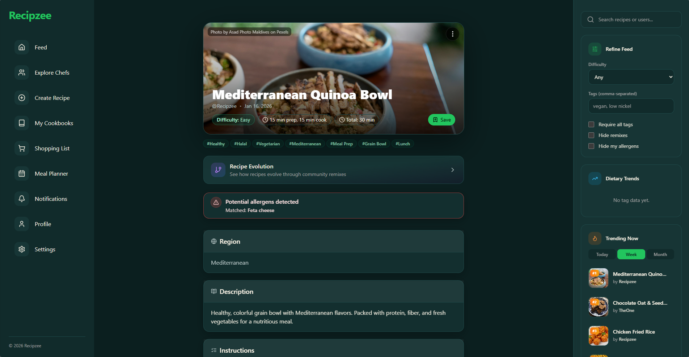
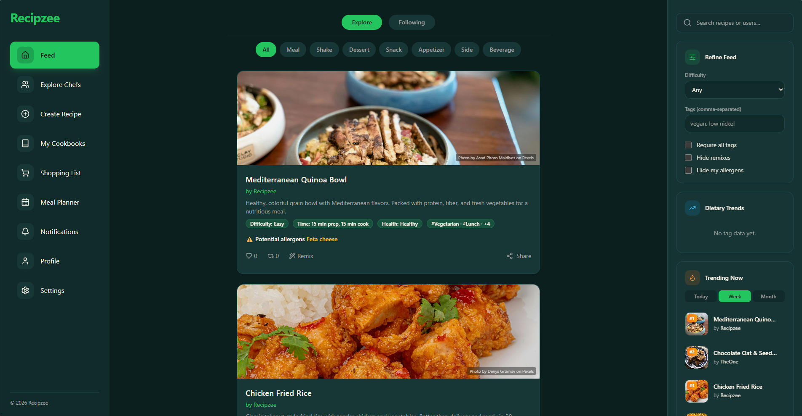
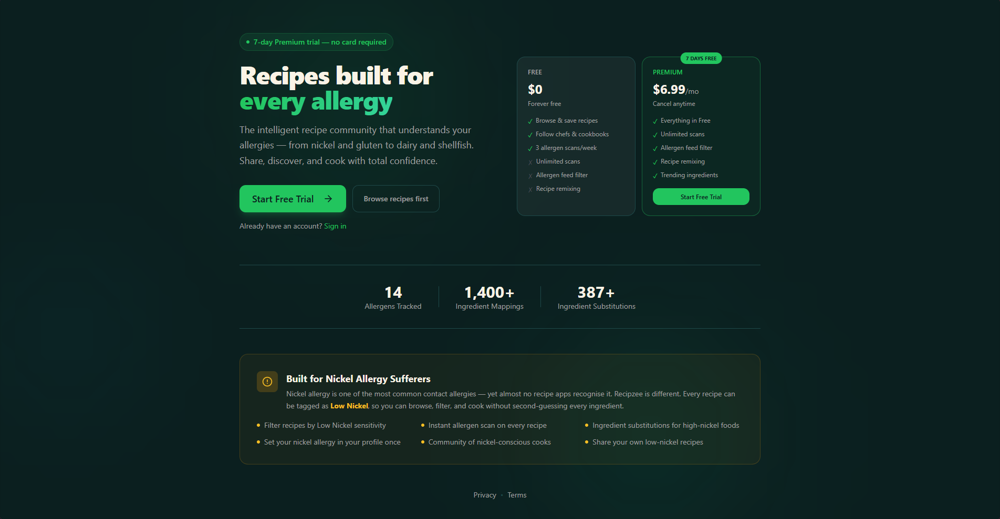
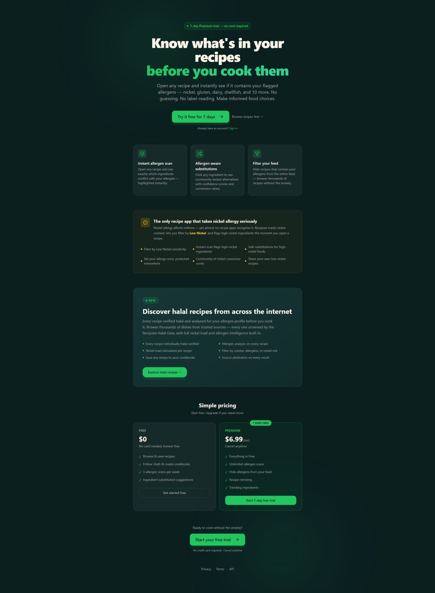
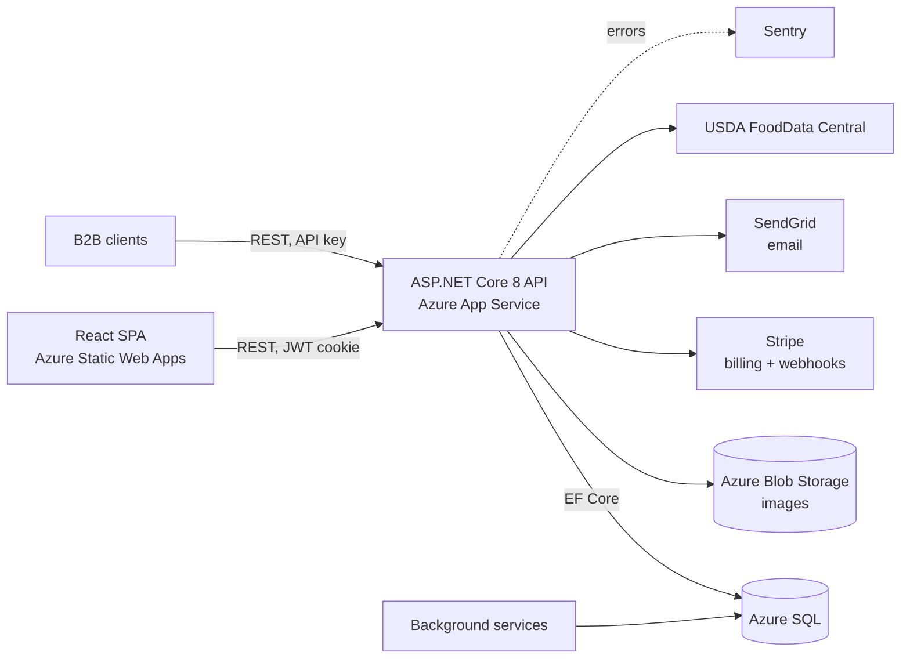

# Recipzee: backend API

**An allergy-aware recipe platform for home cooks and food businesses.** Recipzee (originally Platerly) scanned every recipe against a user's allergies the moment they opened it, from gluten and dairy to nickel, an allergy almost no other recipe app tracks. It also offered a paid API that businesses could use to check recipes for allergens and generate Canadian allergen labels.

I designed, built and launched it solo, then ran it with a small group of early users. This repo is the ASP.NET Core API; the React app lives in [platerly-frontend](https://github.com/Platerly/platerly-frontend).

> **Status:** Launched and tested with early users. No longer in active development or hosted. The code is kept here as a portfolio piece.



<table>
  <tr>
    <td width="50%"></td>
    <td width="50%"></td>
  </tr>
  <tr>
    <td align="center"><sub>Feed: allergen warnings on every card, refine filters, trending</sub></td>
    <td align="center"><sub>Landing page and pricing (free + $6.99/mo premium)</sub></td>
  </tr>
</table>

<details>
<summary>Full landing page</summary>



</details>

---

## At a glance

| | |
| --- | --- |
| **Built** | July 2025 – October 2026, about 350 commits across backend and frontend |
| **Backend** | ASP.NET Core 8, C#, EF Core 9, SQL Server (62 migrations) |
| **Frontend** | React 18, Vite, Tailwind, React Router, Vitest |
| **Infrastructure** | Azure App Service, Azure SQL, Azure Blob Storage, Azure Static Web Apps + Functions |
| **Services** | Stripe (subscriptions + webhooks), SendGrid, Sentry, USDA FoodData Central |

---

## What it does

**For home cooks**
- Onboarding that records each user's allergens and dietary needs, then flags unsafe recipes and suggests ingredient substitutions
- 14 allergens tracked across 1,400+ ingredient mappings, with 387+ substitutions (figures at launch)
- Nickel allergy support: per-recipe nickel load, a Low Nickel filter and flags for high-nickel ingredients
- Free tier with 3 allergen scans a week; Premium at $6.99/month for unlimited scans, allergen-free feeds and remixing
- Recipes, remixes (adapt someone's recipe into a safe version), cookbooks, follows, likes, comments and notifications
- Meal planner and shopping lists with ingredient quantity parsing
- Halal filtering, with ingredient checks for pork, alcohol and their derivatives
- Free trial and paid subscriptions through Stripe

**For businesses (B2B API)**
- API keys with per-key rate limiting and usage logging
- Recipe allergen scanning and ingredient substitution endpoints
- Bilingual (English/French) allergen declarations formatted for Canadian (CFIA) food packaging
- Outbound webhooks with retry, and an embeddable recipe widget

---

## Architecture



The API is a layered ASP.NET Core app: controllers handle HTTP, services hold the business logic behind interfaces, and EF Core maps the domain model to SQL Server. Seven hosted background services run alongside the API:

| Background service | Job |
| --- | --- |
| `TrendingRecomputeService` | Recalculates trending recipes on a schedule |
| `TrialEmailService` | Runs the 7-day trial drip email campaign |
| `WebhookDispatchService` | Delivers pending B2B webhook events every 30 seconds, with retry |
| `AllergenMonitoringBackgroundService` | Hourly allergen change detection for B2B monitoring subscriptions |
| `RecipeIndexingBackgroundService`, `GeneralRecipeIndexingBackgroundService` | Index public recipes from allowed sources, respecting robots.txt |
| `RecipeAnalysisPipelineBackgroundService` | Runs allergen, halal and nutrition analysis on indexed recipes |

---

## Engineering highlights

### Allergen detection
Ingredient names are messy ("2% milk", "whey powder", "beurre"). The pipeline normalizes names, matches them against a global ingredient table with aliases, and loads structured allergen rows for each match. When the database has no data for an allergen, a keyword-expansion fallback maps root terms like "milk" to related ingredients, each with a severity rating. The same data drives user warnings, substitution suggestions and the CFIA label generator.

### Billing with Stripe
Consumer and B2B plans use Stripe Checkout and the Customer Portal. A signature-verified webhook endpoint mirrors subscription state onto the user (checkout completed, subscription created, updated and deleted), and an idempotent email orchestrator sends the matching SendGrid emails exactly once. New users get a 7-day premium trial with a drip email campaign, and can cancel and resume without contacting support.

### B2B API platform
API keys are shown to the customer once and stored only as a 16-character prefix plus a SHA-256 hash; lookups use the prefix, then compare hashes, so no plain-text key ever sits in the database. A custom authentication handler validates the key and puts its plan limits into the request's claims. Middleware then enforces per-key rate limits (returning 429 when exceeded) and logs usage for billing and analytics. Webhook events are written to a table and delivered by a background worker with retries, so a slow partner endpoint never blocks a request.

### Responsible crawling
The recipe indexer checks each site's robots.txt for a `Recipzee-Bot` rule first, then the wildcard rule, before fetching anything.

### Production hardening
HttpOnly, Secure cookies for browser sessions (separate access and refresh tokens), global exception middleware, request logging, security headers, a configurable CORS allow-list, Sentry error tracking, and admin audit logs.

---

## Running locally

**Requirements:** .NET 8 SDK and SQL Server (LocalDB works). Stripe, SendGrid, Azure Storage and Sentry keys are only needed for those features.

```bash
git clone https://github.com/Platerly/platerly-backend.git
cd platerly-backend

dotnet user-secrets init
dotnet user-secrets set "ConnectionStrings:DefaultConnection" "Server=(localdb)\\MSSQLLocalDB;Database=Recipzee;Trusted_Connection=True;"
dotnet user-secrets set "Jwt:Key" "<random string, 32+ characters>"
# Optional: Stripe:SecretKey, Stripe:WebhookSecret, SendGrid:ApiKey, Sentry:Dsn, Azure storage settings

dotnet ef database update
dotnet run
```

Secrets are read from configuration and never committed.

---

## What I learned

- **Scope is the enemy of launch.** I kept adding features (analytics, B2B tools, meal planning) before finding out what early users actually wanted. Next time I'd ship one core feature, get it in front of users, and only then expand.
- **Size infrastructure to real usage.** Hosting ran over $200 a month on Azure before there was revenue to cover it, which is ultimately why I shut it down. A leaner setup could have run the early version for close to nothing.
- **Tests earn their keep.** This codebase has very little automated test coverage, which made late changes slower and riskier than they needed to be. It's the first thing I'd add.
- **Working with AI tools.** I used Claude Code throughout, reading, reviewing and fixing what it produced. It sped up the build a lot, and it also made scope creep easier, because adding a feature felt cheap.

---

## Author

**Ayub Ali** · [GitHub](https://github.com/ayubmja2) · [LinkedIn](https://www.linkedin.com/in/ayubmja/)
